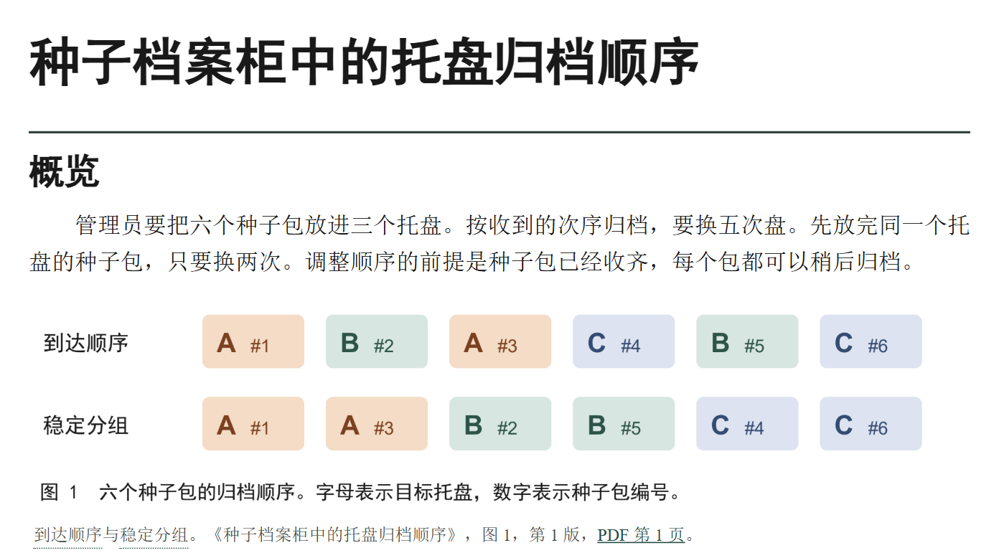
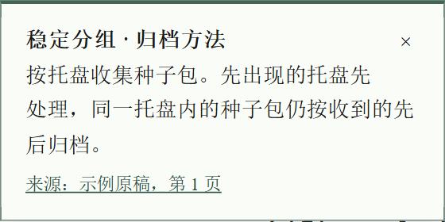
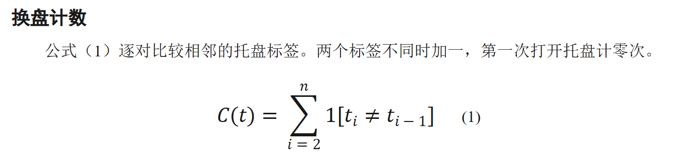

# PaperReader · 论文阅读报告

把论文 PDF 交给 Codex，得到一份可以离线打开的 HTML 报告。从研究动机读到方法和实验，遇到术语可以就地查看释义，读到原图可以放大查看。支持用中文或英文提问，也可以单独指定报告语言。

[中文完整版](examples/seed-archive/full-zh.html) · [中文简版](examples/seed-archive/simple-zh.html) · [示例原稿 PDF](examples/seed-archive/seed-archive.pdf) · [安装方法](#安装方法)

## 一个六包种子的例子

六个种子包要放进 A、B、C 三个托盘。先收到哪个就先放哪个，需要换五次盘。如果等六个包都到齐，先放完 A 盘，再放 B 盘和 C 盘，只需要换两次。下面的截图来自 PaperReader 为这份虚构原稿制作的中文报告。图中每个包都保留了编号，可以对照两行检查它去了哪里。

从上方链接进入 HTML 文件页，点击 **Download raw file** 下载，再用浏览器打开，即可亲手试用术语卡片、原图放大和打印。正文、图片、公式和卡片都保存在同一个文件里。

### 术语卡片与原文公式

<table>
  <thead>
    <tr><th width="38%">术语卡片</th><th width="62%">原文公式</th></tr>
  </thead>
  <tbody>
    <tr>
      <td valign="middle"></td>
      <td valign="middle"></td>
    </tr>
    <tr>
      <td>点击正文里的“稳定分组”，就能看到如何分组、组内按什么顺序摆放，以及定义来自哪一页。按 Esc 回到正文。</td>
      <td>公式沿用原稿编号。相邻两个标签不同就加一，第一次开盘计零次。完整版还逐对列出五次比较，可以跟着算出结果。</td>
    </tr>
  </tbody>
</table>

### 完整版与简版

| 阅读内容 | 完整版 | 简版 |
| --- | --- | --- |
| 概览 | 说明研究问题、主要结果和适用条件 | 保留完整概览 |
| 动机与方法 | 追踪每个种子包的去向，逐项复算换盘次数 | 保留分组顺序、核心公式和使用条件 |
| 实验与限制 | 对照两批输入，说明什么时候能少换盘，以及计数能说明什么 | 保留相同的输入、结果表和限制 |

## 安装方法

1. [下载仓库 ZIP](https://github.com/ZJtoast/PaperReader-Skill/archive/refs/heads/main.zip) 并解压。
2. 将整个 [paper-reader](paper-reader/) 文件夹复制到 `~/.codex/skills/`。如果设置了 `CODEX_HOME`，请复制到该目录下的 `skills/`。
3. 新开一个 Codex 聊天，附上论文 PDF，或给出文件路径、论文链接。

建议搭配仓库中的 [AGENTS.md](AGENTS.md) 使用，其中包含中文表达、标题、公式和图表的写作约定。

## 使用示例

> 用 $paper-reader 把这篇论文做成中文完整版。请用一个可以手算的例子，讲清主算法的输入、每一步的决定和输出。

> 用 $paper-reader 生成中文简版。缩短动机和方法，保留实验配置、对比结果和局限。

> 用 $paper-reader 为这篇论文分别生成中文和英文简版，每种语言各一份 HTML。
